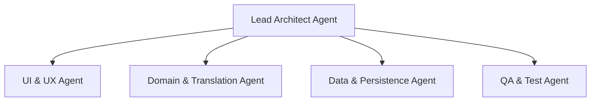

# AGENTS.md — AI Agent Definitions & Guidelines

This document defines the roles, responsibilities, architecture rules, and workflows for AI Agents collaborating on the **Vtt2Srt** codebase.

---

## 🤖 Agent Ecosystem Overview

The **Vtt2Srt** codebase is a modern Android application built in Java 21 adhering strictly to **Clean Architecture**, **MVVM**, **SOLID Principles**, and **Gang of Four (GoF) Design Patterns**. 

AI Agents working on this project must operate within defined roles to ensure code quality, maintainability, and alignment with project patterns.

---

## 👥 Agent Roles & Responsibilities

### 1. 🏛️ Lead Architect Agent
- **Focus**: System architecture, Clean Architecture enforcement, SOLID compliance, and code consistency.
- **Responsibilities**:
  - Ensures domain logic remains decoupled from Android SDK frameworks.
  - Enforces design patterns (Strategy, Decorator, Chain of Responsibility, Factory, Builder).
  - Guarantees backward compatibility and thread safety across multi-threaded operations.

### 2. 🎨 UI & UX Agent
- **Focus**: User Interface, Material 3 design system, Edge-to-Edge integration, and responsiveness.
- **Responsibilities**:
  - Manages `activity_main.xml`, `dialog_translation_settings.xml`, `item_cue.xml`, and Material 3 components.
  - Implements and maintains modern bottom sheet behaviors (`BottomSheetBehavior`), drag handling, and smooth layout padding transitions.
  - Manages dual localization (English & Arabic) and supports RTL/LTR text orientation fixes.

### 3. ⚡ Domain & Translation Core Agent
- **Focus**: Core subtitle parsing, conversion algorithms, AI translation engines, and concurrent execution.
- **Responsibilities**:
  - Maintains `VttParser` (WebVTT specification handling) and `SrtWriter` (SRT formatting).
  - Manages AI Translation implementations (`GeminiTranslator`, `DeepSeek`, `ClaudeTranslator`, `OpenAiCompatibleTranslator`) and fallback providers (`GoogleTranslator`, `MyMemoryTranslator`).
  - Manages thread-safe parallel translation pipelines (`TranslateSubtitlesUseCase`) using `ExecutorService` and atomic primitives (`AtomicBoolean`, `AtomicInteger`).

### 4. 💾 Data & Persistence Agent
- **Focus**: Data layer, HTTP networking, Storage Access Framework (SAF), and settings repositories.
- **Responsibilities**:
  - Manages `TranslationSettingsRepository` for AI provider configs and `SubtitleFileRepository` for URI document operations.
  - Maintains light, zero-dependency HTTP communications via `SimpleHttpClient`.

### 5. 🧪 QA & Test Agent
- **Focus**: Test coverage, regression testing, and build verification.
- **Responsibilities**:
  - Maintains unit tests in `ConversionTest.java` covering parsers, writers, translation pipelines, and language options.
  - Executes Gradle build tasks (`app:assembleDebug`, `app:testDebugUnitTest`) to verify code before merging changes.

---

## 📜 Coding Guidelines & Project Rules

1. **Clean Architecture Dependencies**:
   - `domain/` contains pure Java core logic without any `android.*` imports.
   - `ui/` communicates with `domain/` through `ViewModel` and `LiveData`.
2. **Multi-Language & Direction Support**:
   - Support target languages dynamically via `SubtitleLanguage` definitions.
   - Honor `rtlMarks` for RTL languages (Arabic, Persian, Urdu, Hebrew) using unicode RLM (`\u200F`).
3. **Error Handling & Resiliency**:
   - Always wrap translation network requests with retry (`RetryingTranslator`) and fallback (`FallbackTranslator`) layers.
4. **Verification Requirement**:
   - Before completing any task, run unit tests via Gradle:
     `gradle_build("app:testDebugUnitTest")`
